<div align="center">


# Ledgerly

**Every book, every rupee — beautifully organised.** Ledgerly is a modern, multi-ledger take on the classic ledger book: each ledger inside the app is a "CashBook", with charts, categories and insights. Its companion, **Lensly**, puts a lens on your bank statements.

A cross-platform multi-ledger finance app built with Flutter for Android, iOS, Windows and the Web.


</div>

---

## Screenshots

> The screenshots below use built-in **sample data in ₹ (INR)**; signed in, the app uses your own data through the API.

**Sign in & register**

| Sign in (desktop) | Register (mobile) | Sign in (mobile) |
|:--:|:--:|:--:|
| 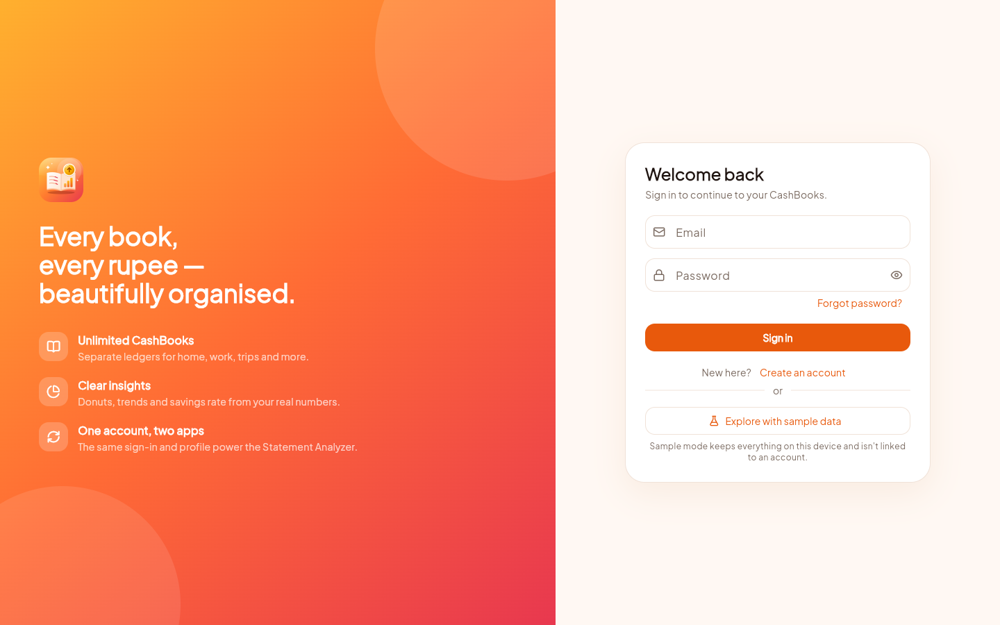 | 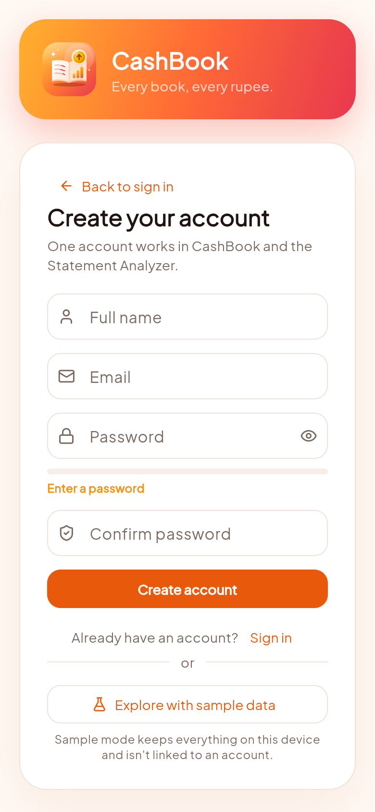 | 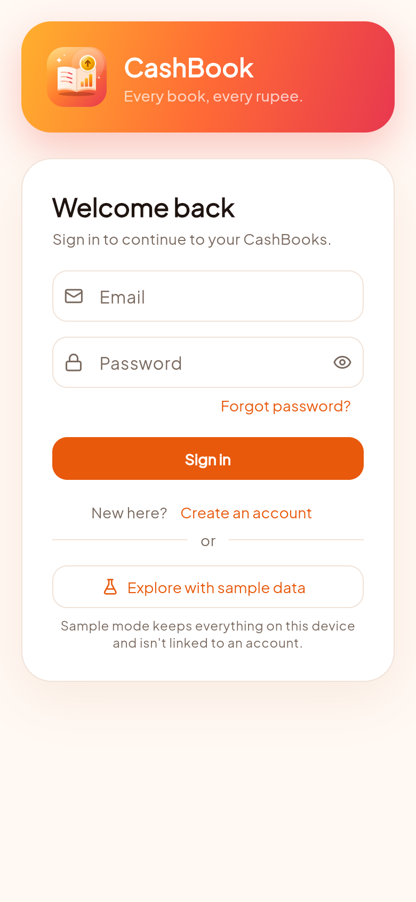 |

**Desktop**

| Dashboard | Insights |
|:--:|:--:|
| 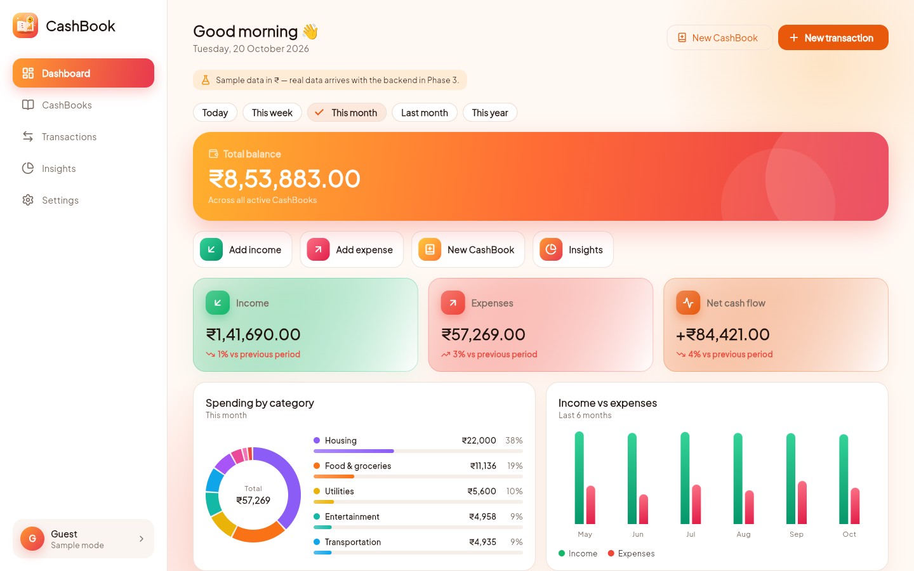 | 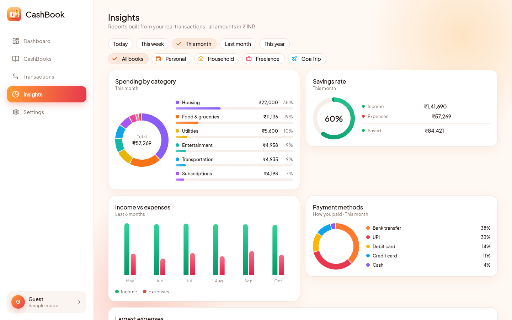 |
| **CashBooks (with the Add CashBook card)** | **CashBook detail** |
| 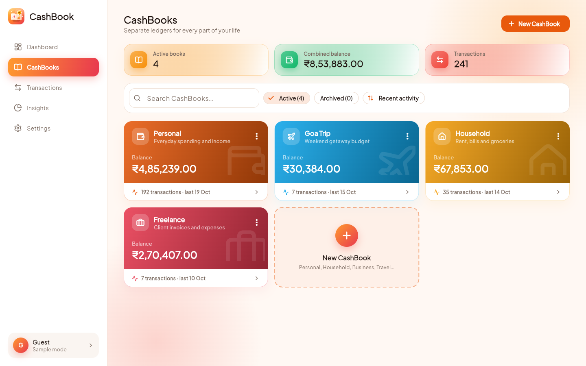 | 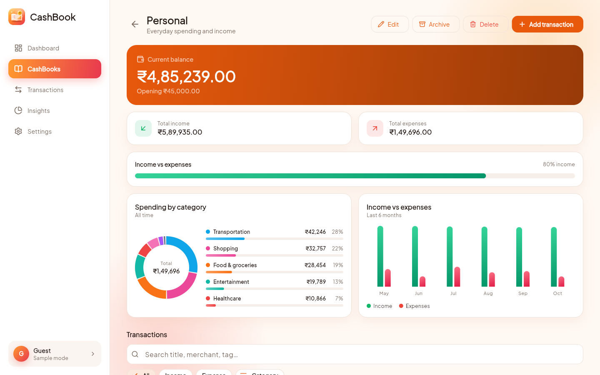 |
| **Transaction timeline** | **Categories & tags** |
| 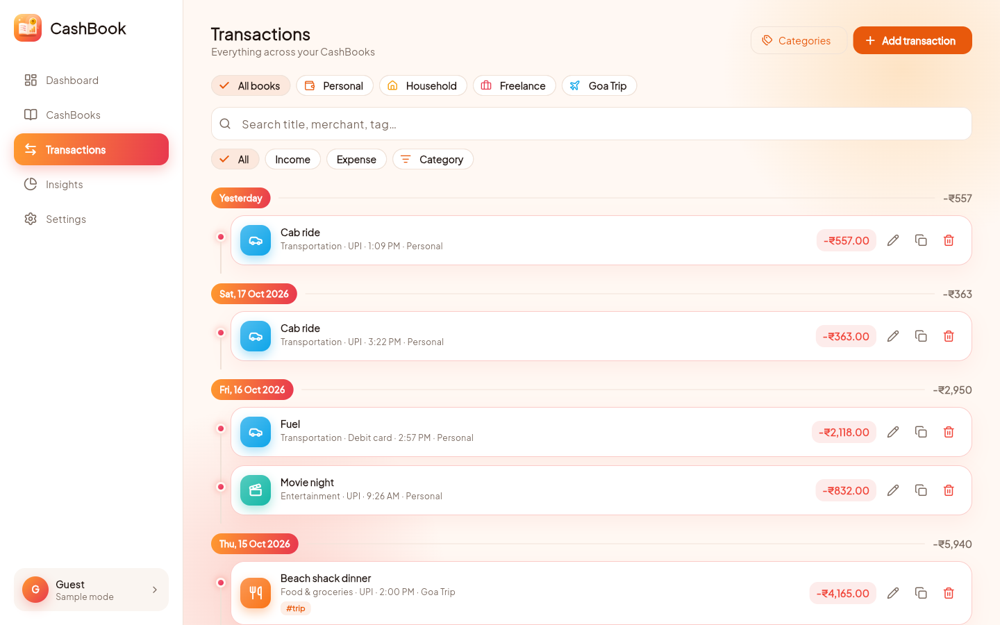 | 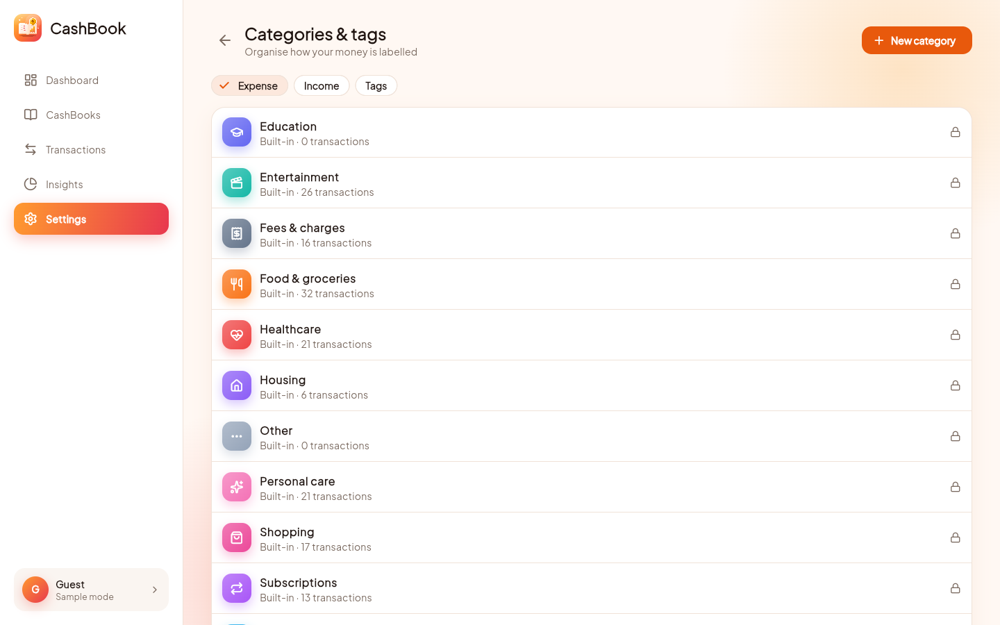 |
| **Account & settings** | |
| 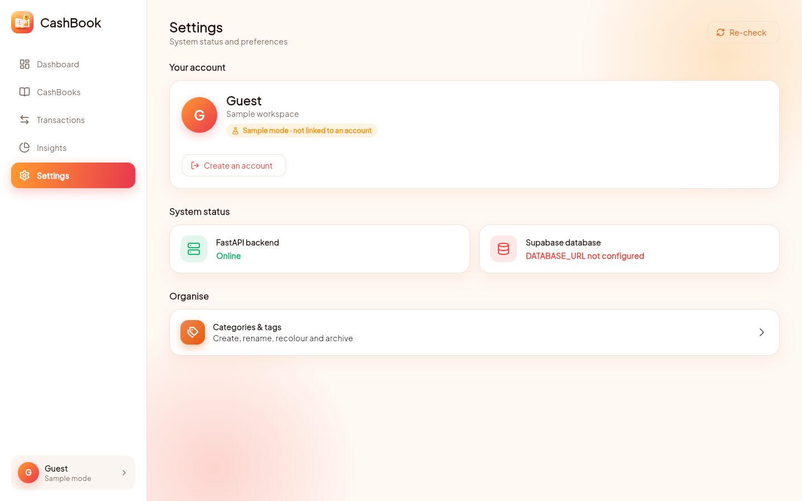 | |

**Mobile**

| Dashboard | CashBooks | Detail | Timeline | Insights | Categories | Settings |
|:--:|:--:|:--:|:--:|:--:|:--:|:--:|
| 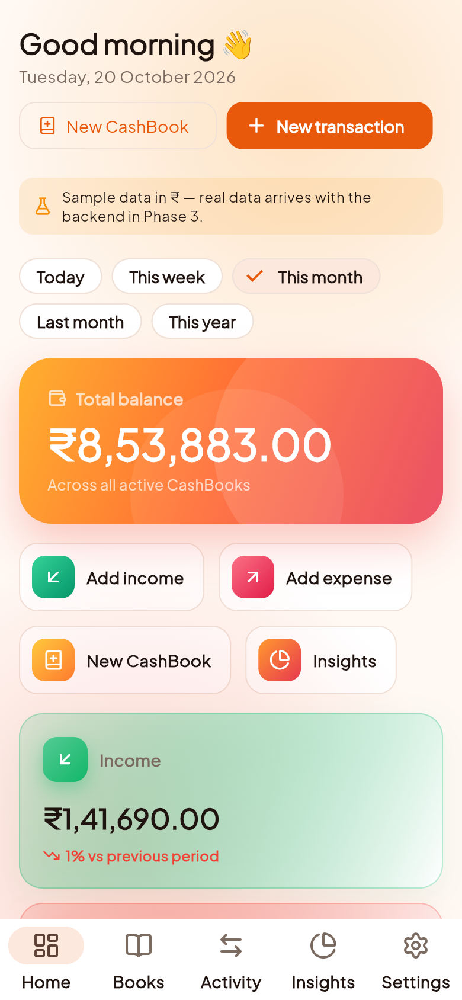 | 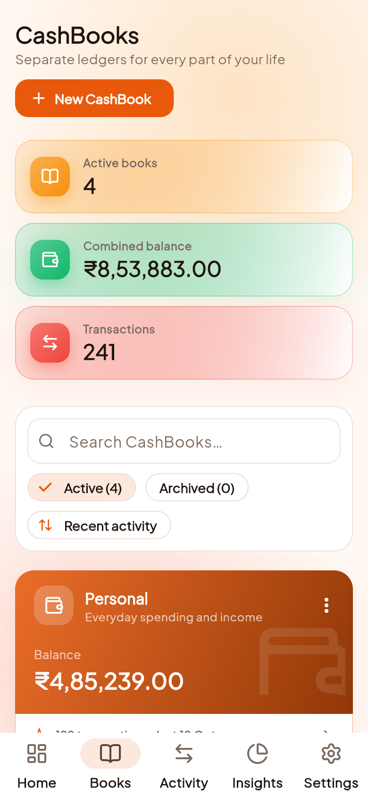 | 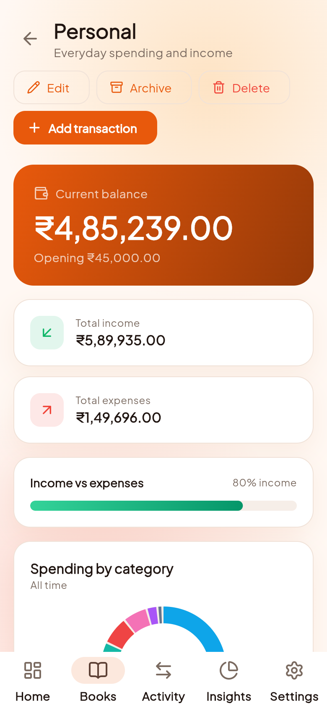 | 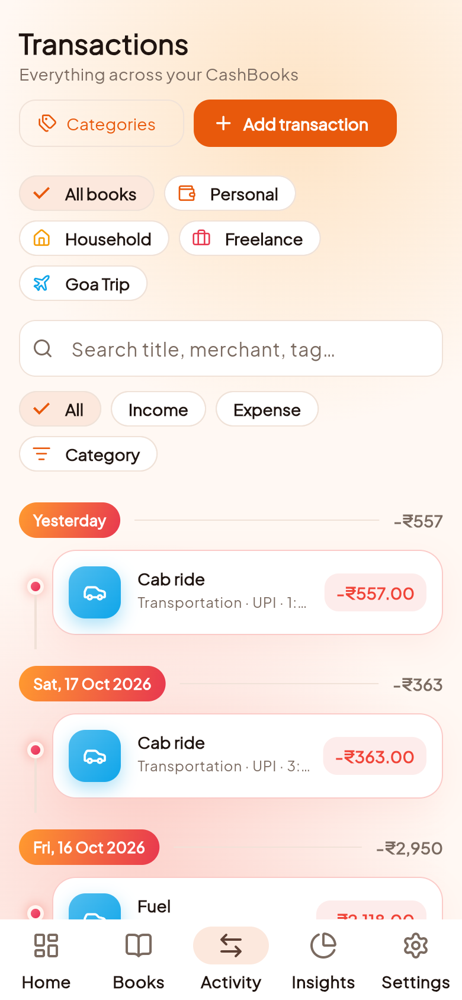 | 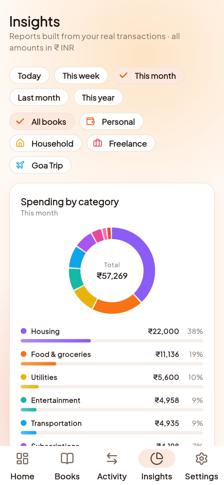 | 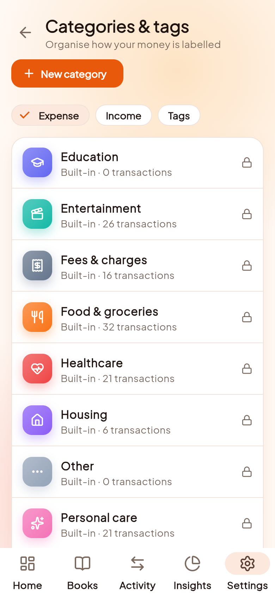 | 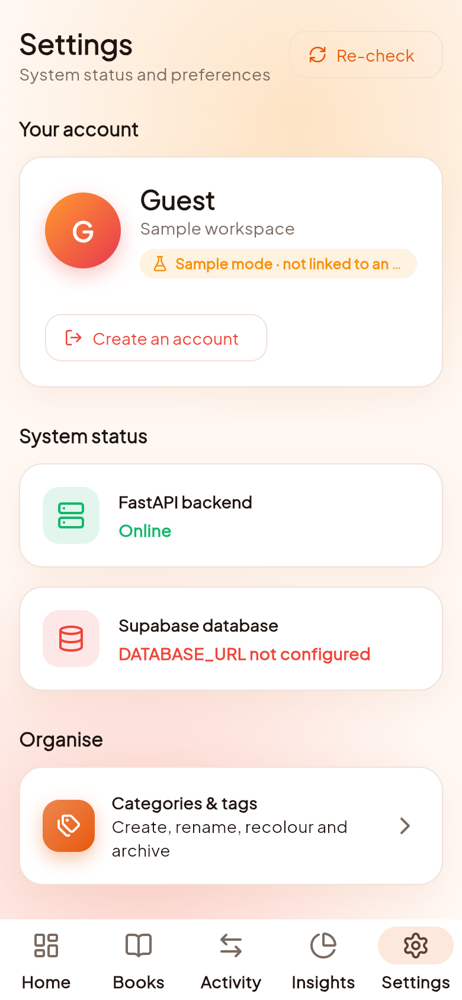 |

The layout adapts automatically: **bottom bar** on phones, **navigation rail** on tablets, **full sidebar** on desktop and web.

## Logo & launcher icons

The mark is an open ledger with a rising bar chart and a gold income coin, on an *Ember & Gold* sunset gradient.

| Logo | Android | Android adaptive (foreground) | iOS | Web / PWA |
|:--:|:--:|:--:|:--:|:--:|
|  |  |  |  |  |

Source art: [`docs/branding/logo.svg`](docs/branding/logo.svg). Launcher icons are generated with `flutter_launcher_icons` (see `pubspec.yaml`) for Android, iOS, Web and Windows.

## Design system

- **Font:** Plus Jakarta Sans (Google Fonts)
- **Palette — Ember & Gold:** ember `#E8590C`, gold gradient to red `#FF9A2F → #E8384F`, income `#12B76A`, expense `#F04438`
- **Themes:** polished light and dark Material 3 themes (follows system setting)
- **Responsive breakpoints:** phone `< 600`, tablet `600–1023`, desktop `≥ 1024` (`lib/core/responsive/breakpoints.dart`)

## Features

### Built today
- **Accounts:** sign in, create account (name, email, password with strength meter), forgot password, sign out, session restore and refresh. Uses **Supabase Auth** — the same accounts as Lensly, the statement analyzer. Tokens go to the platform keystore; passwords are never stored or logged. A profile card shows the **shared profile** (read/updated through the API) so a name change appears in both apps
- **Sample mode:** "Explore with sample data" works without an account (clearly labelled)
- **CashBooks grid** ends with a dashed **Add CashBook** card the same size as a book card, plus a summary strip (active books, combined balance, transactions)

#### Sample-data features (Phases 1–2)
- **Dashboard:** period filters, animated balance and stat cards with period-over-period change, spending-by-category **donut** with ranked **progress bars**, 6-month income vs expenses **bar chart**, savings-rate **progress ring**, top merchants, quick actions, recent transactions, CashBook tiles
- **Insights:** category donut, payment-method donut, savings ring, trend bars, largest expenses; filter by period and CashBook
- **CashBooks (full CRUD):** grid with search, sort and Active/Archived filter; create/edit with starter templates, icon and color; archive/restore; safe delete (books with transactions can only be archived); detail page with charts
- **Transactions (full CRUD):** vertical-rail **timeline** grouped by day with daily subtotals, search, type/category filters, paging; details view; add / edit / duplicate / delete with undo
- **Categories & tags (full CRUD):** create, rename, recolour, change icon, archive/restore, delete unused custom categories; rename or remove tags across transactions. Built-in categories are read-only
- **Motion:** counting money values, sweeping donuts, growing bars and progress, staggered card reveals, fade-through page transitions (all disabled when the OS asks for reduced motion)
- Money held as integer minor units (no floating point); balances are always derived; all sample data is INR
- Loading skeletons, empty and error states, confirmation dialogs, snackbars with undo
- Live backend / database status in Settings (real calls)
- 19 tests: money formatting, balance derivation, category and tag rules, INR data, auth service requests/errors (mock HTTP), password strength, sign-in → sample mode flow, Add CashBook card, phone/tablet/desktop layouts, Insights

> **Signed in, CashBook reads and writes through the API** (optimistic updates, changes sent in order, rolled back with an error banner and Retry if the server refuses or is unreachable). Sample mode keeps the in-memory sample data. Statement imports from Lensly show up as imported, tagged rows. **Your data** (Settings): download everything as JSON, delete CashBook / Analyzer / all data or the account, each behind a typed `DELETE` confirmation. Transfers, attachments, bulk actions, calendar, recurring rules and notifications are not built.
>
> Tests: 31 (fake-server sync tests, signed-in UI tests) plus `test/live_backend_test.dart`, which drives the data layer against the real API on PostgreSQL when `E2E_API_URL` and `E2E_TOKEN` are set. Web and Windows builds succeed (Windows needs a short project path); Android and iOS were not built here.

### Planned (see [`../../docs/checklist.md`](../../docs/checklist.md))
| Area | Highlights | Phase |
|---|---|---|
| Real sign-in | Verify against a real Supabase project (credentials needed) | 3 |
| Transactions | Transfers, bulk actions, CSV export | later |
| Attachments | Private receipts and bills with previews | later |
| Reports & calendar | Daily to yearly reports, recurring transactions | later |
| Productivity | Keyboard shortcuts / command palette (built for the Lensly web app) | later |

## Getting started

```bash
flutter pub get
flutter run -d chrome \
  --dart-define=API_BASE_URL=http://localhost:8000 \
  --dart-define=SUPABASE_URL=https://YOUR_PROJECT.supabase.co \
  --dart-define=SUPABASE_ANON_KEY=YOUR_PUBLIC_ANON_OR_PUBLISHABLE_KEY
flutter test
flutter analyze
```

Only the **public** anon/publishable key goes in the app — never a service-role key. Without Supabase values the sign-in screen says so and offers sample mode (`--dart-define=START_IN_DEMO=true` skips the screen for development).

Other targets: `flutter run -d windows`, or pick an Android/iOS device. The backend setup is in [`../../docs/setup-guide.md`](../../docs/setup-guide.md).

> `google_fonts` is pinned to `^8.2.1`: version 9 depends on the `material_ui` package, whose `TextTheme` is incompatible with Flutter 3.47's own.

## Project structure

```
lib/
├─ app/          router, providers
├─ core/
│  ├─ api/       typed API client
│  ├─ responsive/ breakpoints
│  ├─ theme/     colors + Material 3 themes
│  └─ widgets/   adaptive shell, cards
└─ features/     dashboard, insights, books, transactions, categories, settings, ledger (models, sample store, analytics, chart cards)
```
