

# Ledgerly

**Every book, every rupee, beautifully organised.**

Ledgerly is a modern, multi-ledger take on the classic ledger book. Each ledger inside the app is a "CashBook": keep your business, home and trips separate, and see where the money goes with clear charts, categories and insights.

---

Part of the **Finance Platform**, alongside **Lensly** (statement analyzer) and **Ledgerline** (double-entry accounting). One account signs in to all three.

## Screenshots

> The screenshots use sample data in ₹ (INR). Signed in, the app shows your own data.

**Sign in & register**

| Sign in (desktop) | Register (mobile) | Sign in (mobile) |
|:--:|:--:|:--:|
| 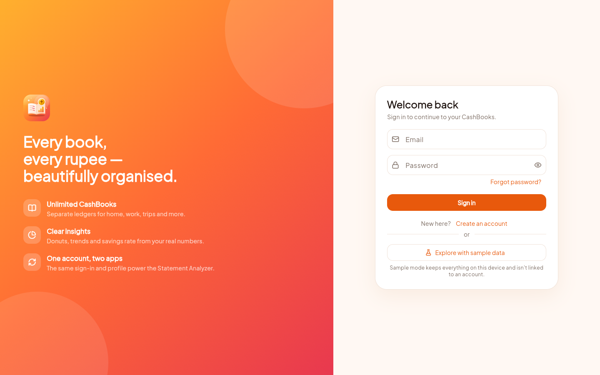 | 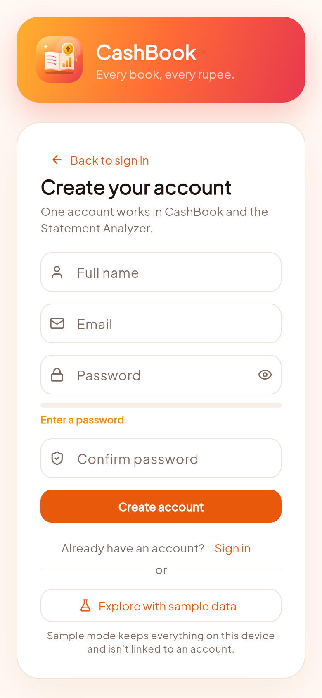 | 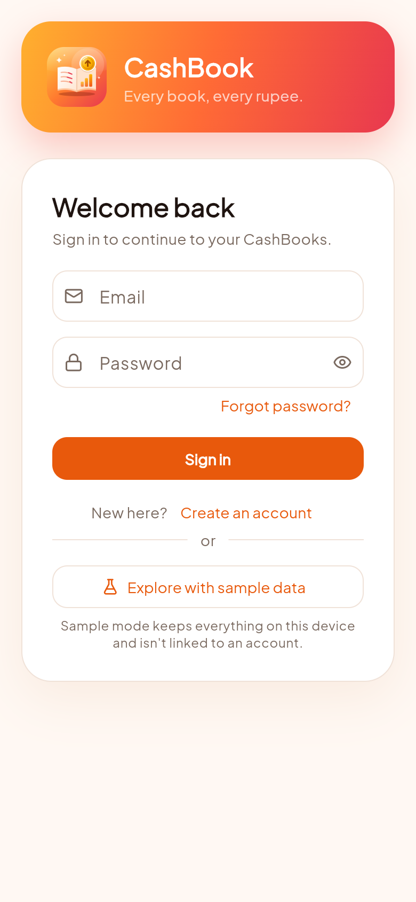 |

**Desktop**

| Dashboard | Insights |
|:--:|:--:|
| 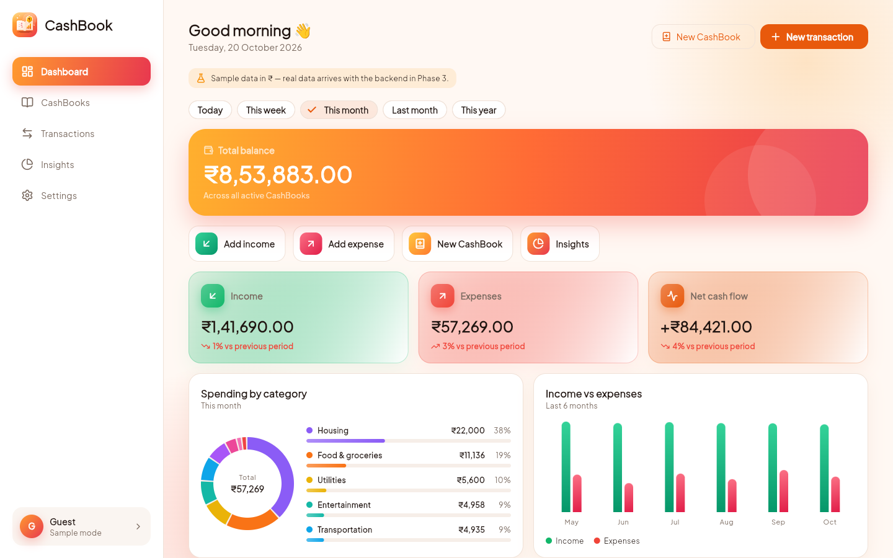 | 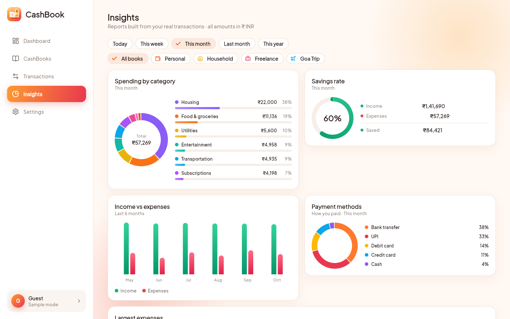 |
| **CashBooks** | **CashBook detail** |
| 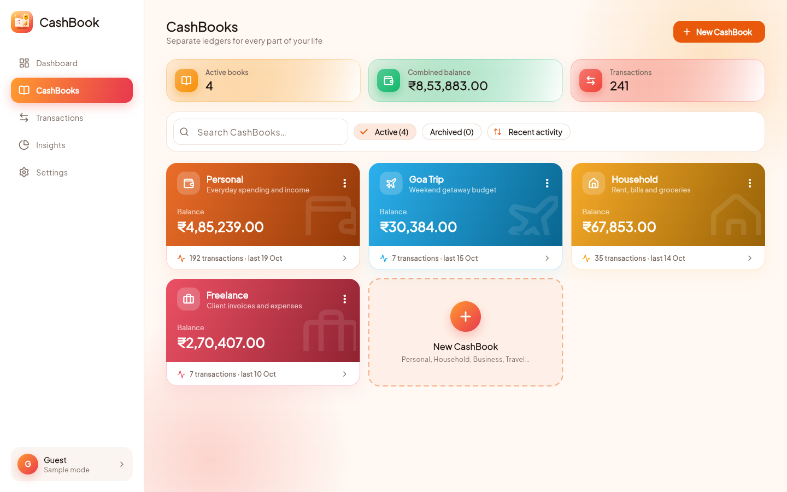 | 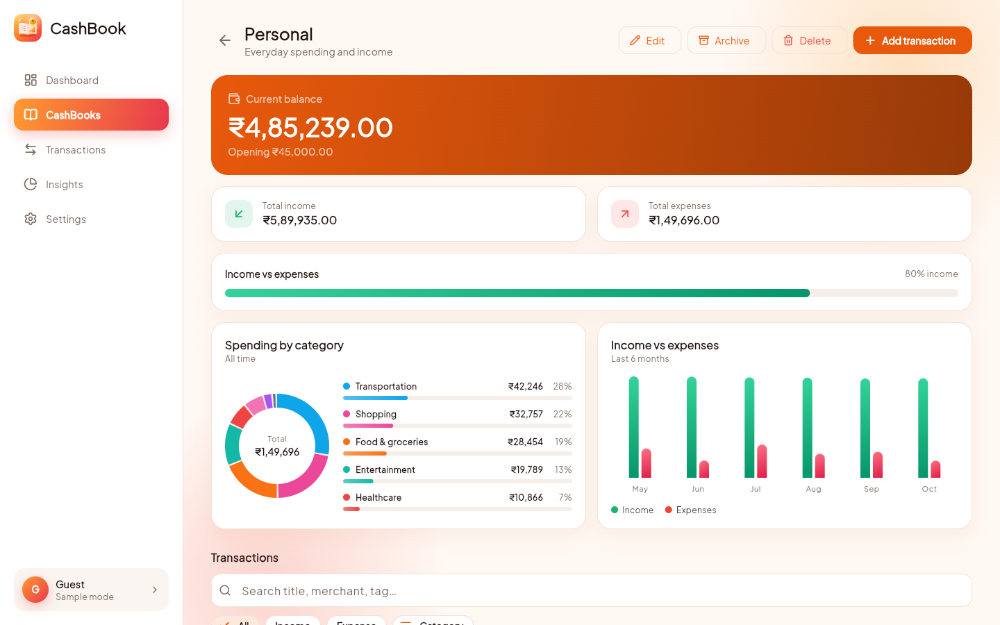 |
| **Transaction timeline** | **Categories & tags** |
| 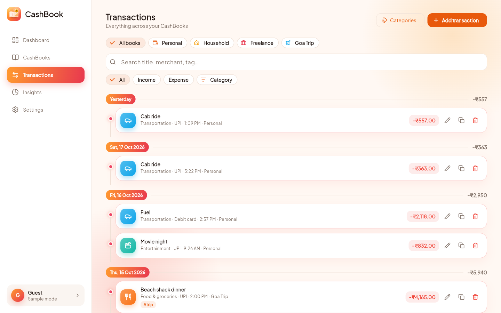 | 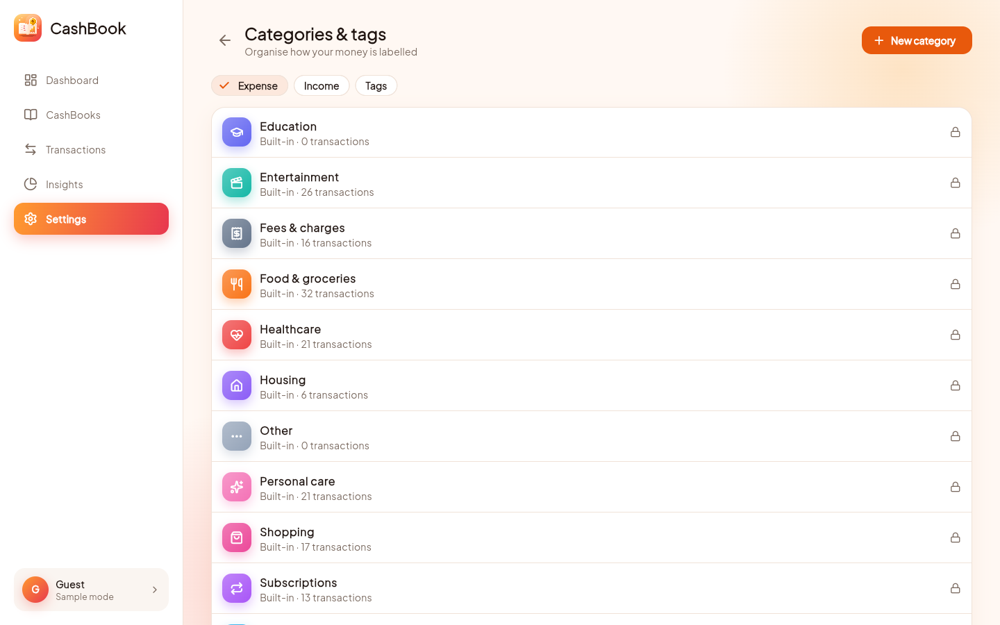 |
| **Account & settings** | |
| 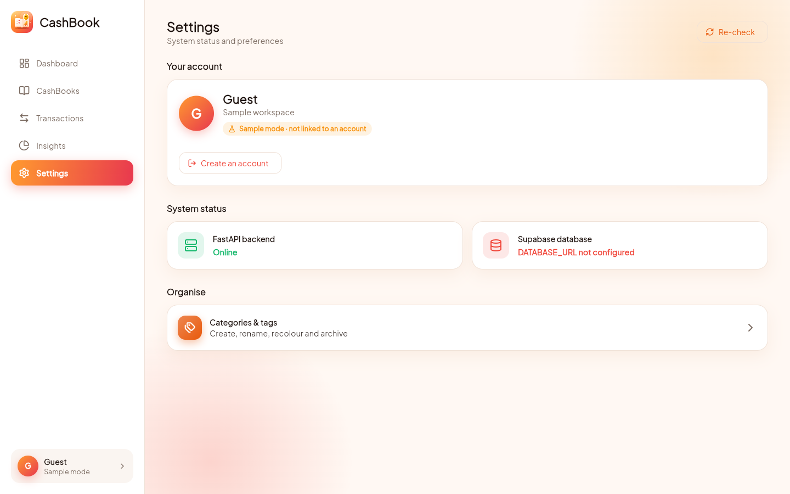 | |

**Mobile**

| Dashboard | CashBooks | Detail | Timeline | Insights | Categories | Settings |
|:--:|:--:|:--:|:--:|:--:|:--:|:--:|
| 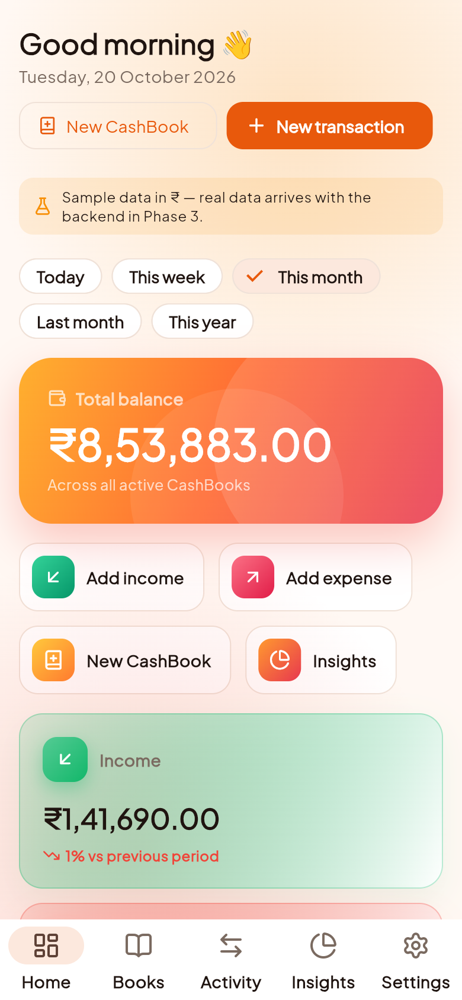 | 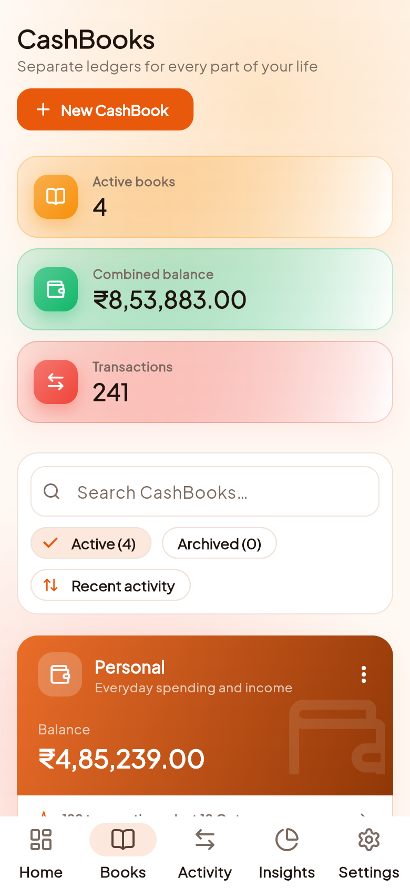 | 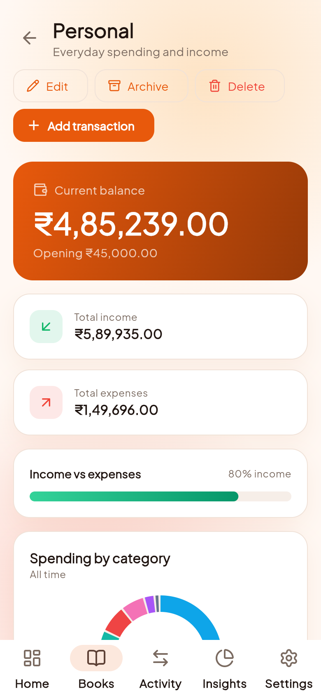 | 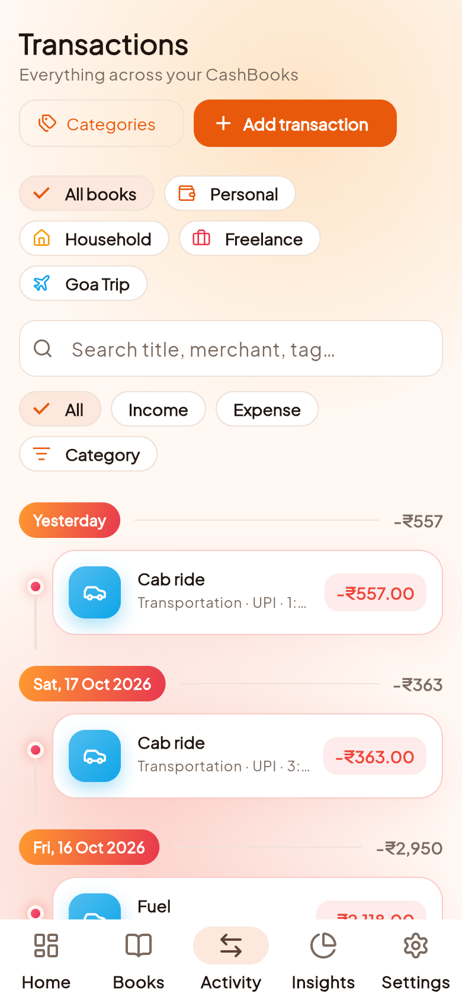 | 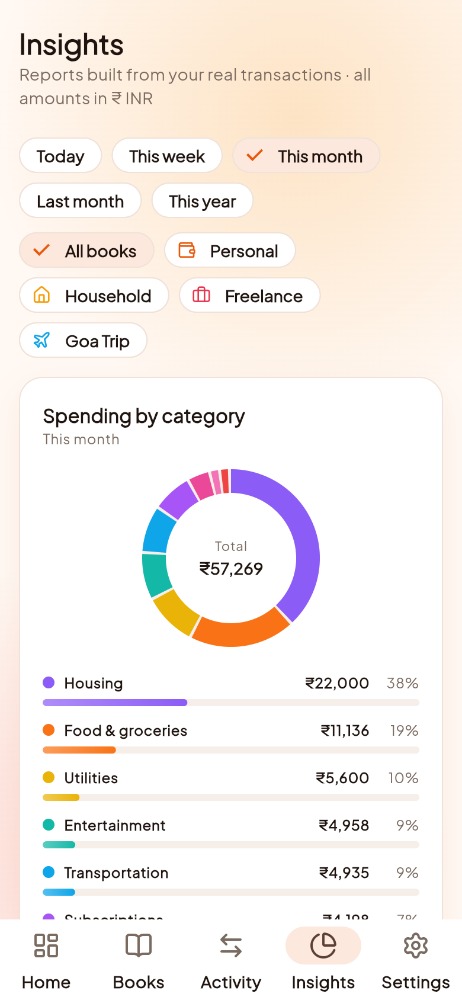 | 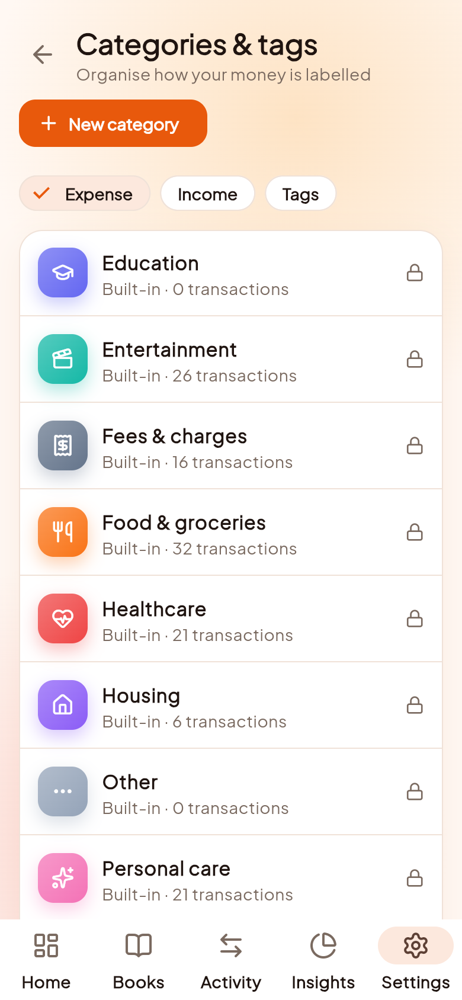 | 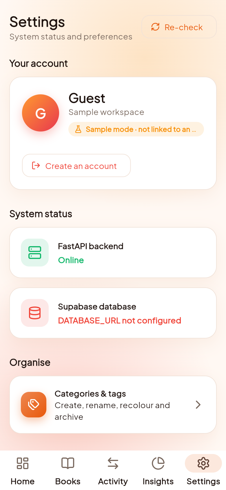 |

The layout adapts automatically: a **bottom bar** on phones, a **navigation rail** on tablets and a **full sidebar** on desktop and the web.

## Logo & launcher icons

The mark is an open ledger with a rising bar chart and a gold income coin, on an *Ember & Gold* sunset gradient.

| Logo | Android | Android adaptive | iOS | Web / PWA |
|:--:|:--:|:--:|:--:|:--:|
|  |  |  |  |  |

Vector original: [`logo.svg`](docs/branding/logo.svg).

## Design

- **Palette, Ember & Gold:** ember `#E8590C`, a gold-to-red gradient `#FF9A2F → #E8384F`, income green `#12B76A`, expense red `#F04438`
- **Font:** Plus Jakarta Sans
- **Light and dark** themes that follow your device setting
- **Motion:** counting money values, sweeping donuts, growing bars and smooth page transitions, all switched off automatically when your device asks for reduced motion

## Features

### Your account
- Sign in, create an account (with a password-strength meter), reset a forgotten password, sign out; your session is restored and refreshed automatically
- The **same account as Lensly and Ledgerline**, with a shared profile: change your name once and it updates everywhere
- Tokens are kept in the device's secure storage; passwords are never stored
- **Explore with sample data** without creating an account (clearly labelled)

### Dashboard
- Balance and stat cards with period-over-period change, filtered by period
- Spending-by-category donut with ranked progress bars
- Six-month income vs expenses chart, savings-rate ring, top merchants, quick actions, recent transactions

### Insights
- Category and payment-method donuts, savings ring, trend bars and your largest expenses
- Filter by period and by CashBook

### CashBooks
- A grid of your ledgers with search, sort and an Active / Archived filter, plus a summary of active books, combined balance and transactions
- Create and edit with starter templates, an icon and a colour; archive and restore
- A book with transactions can be archived but not deleted by accident
- Detail page for each book with its own charts

### Transactions
- A vertical **timeline** grouped by day, with daily subtotals
- Search, filter by type and category, paging
- Add, edit, duplicate and delete, with **undo**

### Categories & tags
- Create, rename, recolour and re-icon categories; archive, restore or delete unused ones
- Rename or remove tags across all your transactions
- Built-in categories are protected

### Works with Lensly
- Reviewed rows imported from a Lensly bank statement appear in your CashBook as imported, tagged transactions

### Your data
- Changes feel instant and roll back with a **Retry** banner if the server can't be reached
- Download everything as JSON
- Delete your CashBook data, your Lensly data, everything, or your account, each behind a typed `DELETE` confirmation
- Live backend and database status in Settings

### Polish
- Loading skeletons, friendly empty and error states, confirmation dialogs and snackbars

## Coming next

| Area | Highlights |
|---|---|
| Transactions | Transfers between books, bulk actions, CSV export |
| Attachments | Private receipts and bills with previews |
| Reports & calendar | Daily to yearly reports, recurring transactions |
| Productivity | Keyboard shortcuts and a command palette |

## Good to know

- Money is held as whole minor units (paise), never as floating-point numbers, and balances are always calculated from your transactions.
- Runs on Android, iOS, Windows and the web from one codebase.
- Your data is private to your account and is read and written through the platform's secure API.
